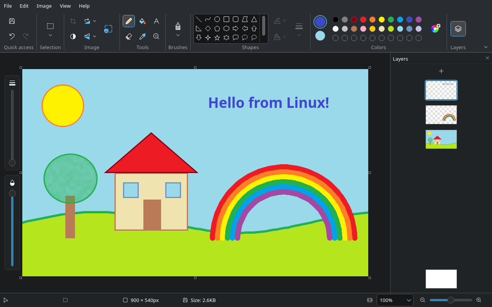
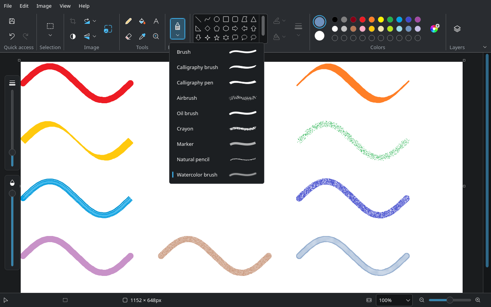
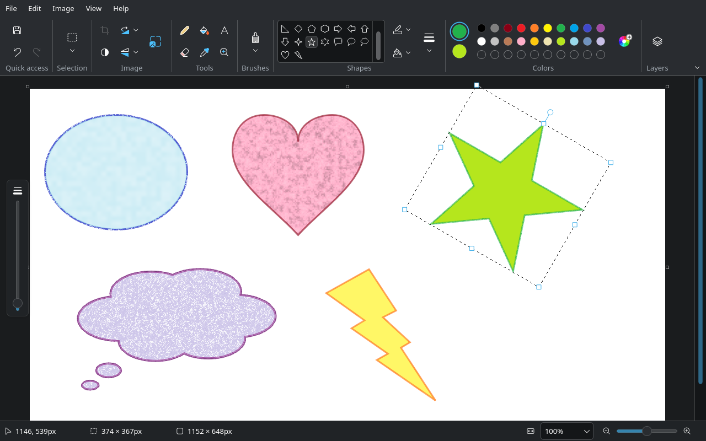
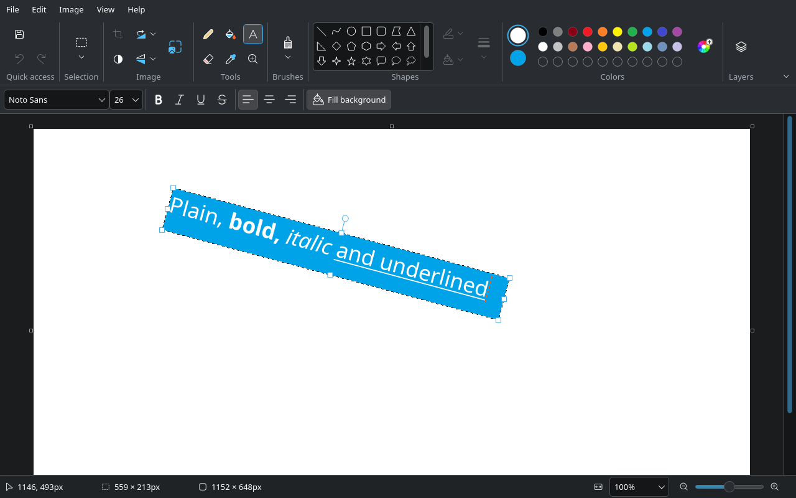
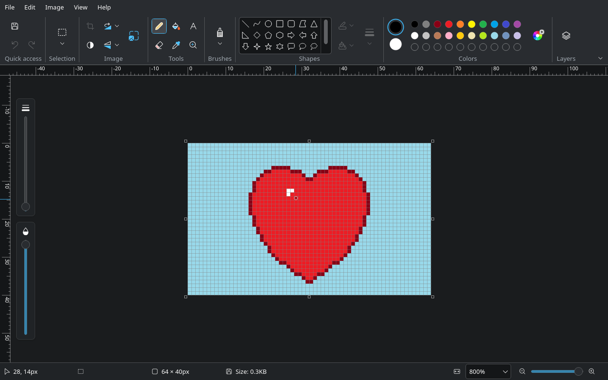

<div align="center">


# Paint for Linux

**The drawing app from Windows 11, as a native Linux application.**

[](https://github.com/mikigal/paint-linux/releases/latest)
[](LICENSE)
[](https://www.qt.io)

</div>



Paint for Linux keeps Paint's tools, ribbon, icons and way of working, and fits them into the Linux
desktop: it uses the system menu bar (including Plasma's global menu), native file and print
dialogs, your colour scheme and window decorations, on Wayland and X11. Everything Paint does is
here except its AI features and Microsoft services.

<table>
  <tr>
    <td width="50%"></td>
    <td width="50%"></td>
  </tr>
  <tr>
    <td align="center">Nine brushes, from calligraphy pen to watercolor</td>
    <td align="center">23 shapes you can move, resize, rotate and restyle until you place them</td>
  </tr>
  <tr>
    <td width="50%"></td>
    <td width="50%"></td>
  </tr>
  <tr>
    <td align="center">Text with fonts, styles, alignment and a background</td>
    <td align="center">Zoom to 800 % with rulers and gridlines</td>
  </tr>
</table>

## Features

- **Drawing**: pencil, nine brushes, eraser, fill with tolerance, colour picker and magnifier, with
  size and opacity sliders.
- **Shapes**: line, curve, polygon and 20 more, with outline and fill styles in the brushes'
  textures, editable until placed.
- **Text**: any installed font, bold, italic, underline, strikethrough, alignment, background fill
  and rotation.
- **Selections**: rectangle and free-form, moved, resized and rotated by their handles, with
  transparent selection and crop.
- **Image**: resize and skew, rotate, flip, invert colours, canvas handles and image properties.
- **Layers**: add, duplicate, hide, reorder and merge, with a background colour; projects are saved as
  OpenRaster (`.ora`), which GIMP, Krita and MyPaint open.
- **Files**: PNG, JPEG, 1/4/8/24-bit bitmaps, GIF, TIFF and HEIC; WebP, AVIF, JPEG XL, PSD and more
  open with Qt's and KDE's image format plugins. Print, page setup and print preview, recent files, and
  setting the picture as the desktop background.
- **Clipboard**: paste pictures from any application, or drag in files and images from file managers
  and browsers.
- **Accessibility**: every command works from the keyboard, and screen readers name every control.

The [feature matrix](docs/feature-matrix.md) compares every Paint feature with its Linux form.

## Installing

Download a package for your system from the
[latest release](https://github.com/mikigal/paint-linux/releases/latest):

| System | Install the downloaded file with |
|---|---|
| Arch Linux, CachyOS | `sudo pacman -U ./paint-for-linux-*-x86_64.pkg.tar.zst` |
| Debian 13 | `sudo apt install ./paint-for-linux_*_debian13_amd64.deb` |
| Ubuntu 26.04 and newer | `sudo apt install ./paint-for-linux_*_ubuntu26.04_amd64.deb` |
| Fedora 44 | `sudo dnf install ./paint-for-linux-*.fedora44.x86_64.rpm` |
| openSUSE Tumbleweed | `sudo zypper install --allow-unsigned-rpm ./paint-for-linux-*.opensuse-tumbleweed.x86_64.rpm` |
| openSUSE Leap 16.0 | `sudo zypper install --allow-unsigned-rpm ./paint-for-linux-*.opensuse-leap16.0.x86_64.rpm` |
| Any other distribution | `chmod +x paint-for-linux-*-x86_64.AppImage`, then run the AppImage |
| Any other distribution | `tar -xzf paint-for-linux-*-x86_64.tar.gz`, then run `paint-for-linux` in the folder |

The distribution packages use the system's Qt and follow your desktop's style. The AppImage and the
tar.gz bring their own Qt, need glibc 2.35 or newer (Ubuntu 22.04, Debian 12, Fedora 36 and later)
and draw controls in Qt's Fusion style.

Optional extras: `kimageformats` for HEIC, AVIF, JPEG XL, PSD and XCF; `qt6-imageformats` for TIFF
and WebP; `xdg-desktop-portal` for setting the desktop background.

## Building from source

Requirements: CMake ≥ 3.25, Ninja, a C++20 compiler, Qt ≥ 6.8 (Core, Gui, Widgets, Svg, Network,
PrintSupport, DBus; Test for development builds) and libzip ≥ 1.7.

```bash
cmake --preset dev            # Debug, tests and automation server enabled
cmake --build --preset dev
./build/dev/src/app/paint-for-linux
```

Presets: `dev`, `asan` (AddressSanitizer + UBSan), `release` (no tests, no automation) and `bench`
(optimised, with tests; see [Performance](#performance)).

On Arch Linux and CachyOS, `cd packaging/arch && makepkg -si` builds and installs a package from the
tree. Elsewhere, `cmake --install` puts the executable, the `.desktop` entry (with the image types
the app opens), AppStream metadata and the icon under the chosen prefix:

```bash
cmake -S . -B build/install -G Ninja -DCMAKE_BUILD_TYPE=Release -DCMAKE_INSTALL_PREFIX=/usr \
      -DPAINT_BUILD_TESTS=OFF -DPAINT_AUTOMATION=OFF -DPAINT_WARNINGS_AS_ERRORS=OFF
cmake --build build/install && sudo cmake --install build/install
```

`tools/install-dev-desktop.sh` registers the development build with your desktop (a
`pl.mikigal.PaintForLinux.desktop` entry and icon in `~/.local/share`), so the window gets its
name and icon and xdg-desktop-portal recognises the app ID; `--uninstall` removes them.

## Development

App ID: `pl.mikigal.PaintForLinux` · executable: `paint-for-linux`

```
src/core/      image model and algorithms (QtGui only, fully unit-tested)
src/app/       widgets, main window, automation server
tests/         unit/widget tests, golden images, visual scenarios, benchmarks, deterministic environment
packaging/     .desktop entry, AppStream metadata, PKGBUILD, release package scripts
tools/         paintctl.py, headless-session.sh, verify.sh, readme-screenshots.py
docs/          feature matrix, design notes and README screenshots (reference screenshots stay local)
.github/       release workflow
```

### Testing

```bash
tools/verify.sh               # build, tests, formatting, visual regression — run before committing
tools/verify.sh --tidy --asan # plus clang-tidy and a sanitizer build
tools/verify.sh --integration # plus cross-application tests in a headless KWin (needs wl-clipboard)
```

- **Unit and widget tests** (`ctest --preset dev`) run headless on Qt's offscreen platform with a
  checked-in, deterministic KDE environment (`tests/env`: Breeze Light/Dark, Noto Sans 10), so the
  developer's desktop settings never affect results.
- **Golden images**: `PAINT_COMPARE_GOLDEN(image, "name")` compares against `tests/golden/name.png`;
  failures write `*.actual.png` and `*.diff.png` to `build/dev/test-output/`. Accept intended changes
  with `PAINT_UPDATE_GOLDEN=1 ctest --preset dev -R <test>`.
- **Integration**: `tests/integration/*.py` run the app in a headless KWin and exchange images
  with other Wayland clients (`wl-copy`/`wl-paste`) through the real clipboard.
- **Visual regression**: `tests/visual/run.py` drives the real app through scenarios
  (`tests/visual/scenarios.py`) and compares screenshots with `tests/visual/baselines/`; review the
  output and run `tests/visual/run.py --update` to accept changes.

### Driving the app

Development builds contain an automation server (never in release builds). Start the app in an
isolated session and control it with `paintctl`:

```bash
tools/headless-session.sh start --theme dark            # offscreen; or --platform kwin
tools/paintctl.py tree                                    # widgets, object names, actions
tools/paintctl.py click target=menu.file
tools/paintctl.py screenshot path=/tmp/shot.png
tools/paintctl.py drag relativeTo=canvasView.viewport path='[[100,100],[300,200]]'   # draw
tools/paintctl.py call target=mainWindow method=openFile args='["image.png"]'
tools/paintctl.py call target=mainWindow method=documentPixel args='[10,10]'
tools/paintctl.py drop target=canvasView urls='["image.png"]'
tools/headless-session.sh stop
```

`--platform kwin` runs a headless KWin on a private D-Bus session (useful for cross-application
clipboard tests with `wl-copy`); popups only open on the offscreen platform because synthetic input
has no Wayland serial. `tools/readme-screenshots.py` draws this README's screenshots the same way.

### Performance

`ctest --preset bench` (after `cmake --preset bench && cmake --build --preset bench`) times the
operations a user waits for on a 4K picture with three layers. On the development machine: a 300-point
brush stroke 45 ms (crayon 290 ms), rotating and undoing 14 ms, saving a PNG 130 ms, opening 10 ms,
repainting the canvas 0.5–1.5 ms. The undo history keeps up to 100 steps and 1 GiB; the oldest
steps go first.

### Releasing

Set the version in `CMakeLists.txt` and `pkgver` in `packaging/arch/PKGBUILD`, describe the release
in the AppStream metadata (`packaging/pl.mikigal.PaintForLinux.metainfo.xml.in`), commit, then tag
and push:

```bash
git tag v0.1.0 && git push origin v0.1.0
```

The tag starts `.github/workflows/release.yml`: it runs the tests, builds each distribution's package
in a container of that distribution (`packaging/release/build-package.sh`) and the AppImage and
tar.gz in Ubuntu 22.04 (`packaging/release/build-appimage.sh`), installs and starts each one in a
clean container, and publishes a release with all files and `SHA256SUMS`. Started by hand (Actions →
Release → Run workflow) it builds and checks the same files without publishing. The scripts also run
locally with Docker or Podman:

```bash
docker run --rm -v "$PWD:/src" -w /src fedora:44 packaging/release/build-package.sh fedora44
```

## License

Paint for Linux is free software: you can redistribute it and/or modify it under the terms of the
GNU General Public License as published by the Free Software Foundation, either version 3 of the
License, or (at your option) any later version. It is distributed WITHOUT ANY WARRANTY; see
[`LICENSE`](LICENSE). The icons in `resources/icons` derive from Microsoft's Fluent UI System Icons
(MIT License, see `resources/icons/LICENSE.txt`).

Paint for Linux is not affiliated with or endorsed by Microsoft.
